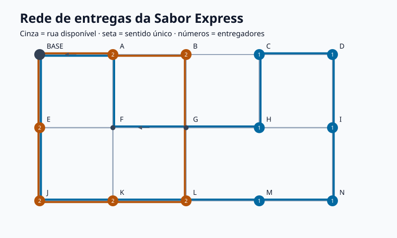

# Rota Inteligente

Projeto de Artificial Intelligence Fundamentals para a Sabor Express, uma empresa fictícia de delivery. O objetivo é distribuir pedidos entre entregadores e ordenar as paradas para reduzir o custo de deslocamento, respeitando sentidos de circulação e vias indisponíveis.

## Execução

Instale Python 3.10 ou superior. Abra o terminal na raiz do projeto. No Windows, use o Git Bash. O programa usa somente a biblioteca padrão.

```bash
python -m src
python -m src --scenario normal --output outputs/normal
python -m src --metric km --output outputs/distancia
python -m src --couriers 1 --output outputs/um-entregador
python -m src --help
```

O primeiro comando simula o pico com dois entregadores e otimização por minutos. O terminal apresenta a comparação. O arquivo `resultados.json` detalha as paradas, o percurso completo, os custos e a comparação entre buscas. O arquivo `grafo.svg` mostra as rotas com K-Means. Use um diretório de saída diferente para preservar cenários anteriores.

## Dados e modelo da cidade

| Arquivo | Conteúdo |
| --- | --- |
| [points.csv](data/points.csv) | Identificador e coordenadas planas de 15 locais, incluindo a base. |
| [streets.csv](data/streets.csv) | Origem, destino, distância em km e tempo em minutos para cada arco dirigido. |
| [orders.csv](data/orders.csv) | Paradas na ordem de chegada, separadas por cenário. Cada parada é única dentro do cenário. |

Cada arco representa um sentido permitido. A rua entre a base e A permite apenas A → BASE. A ligação H–M está bloqueada nos dois sentidos e seus arcos foram omitidos. Os pesos são positivos e estáticos. Todos os entregadores saem da base e retornam à mesma base. Uma parada conta como atendida na ordem planejada, mesmo que o caminho passe antes pelo mesmo cruzamento.



## Algoritmos

1. **Busca A\*.** Expande os nós em ordem de \(g+h\), em que \(g\) é o custo acumulado e \(h\) é a distância euclidiana ao destino multiplicada pelo menor custo por unidade de distância geométrica observado nas ruas. Cada arco custa pelo menos esse fator vezes seu comprimento geométrico. Pela desigualdade triangular, a heurística é consistente e o primeiro caminho encontrado tem custo mínimo no critério escolhido. A comparação com Dijkstra reutiliza o mesmo código com \(h=0\).
2. **K-Means.** Com `k` igual à quantidade de entregadores, o método atribui cada ponto ao centroide mais próximo e recalcula as médias das coordenadas. A semente 42 fixa a inicialização. Caso um grupo fique vazio, ele recebe o ponto mais distante do centroide do maior grupo. O algoritmo para com atribuições estáveis ou ao atingir 100 iterações.
3. **Ordem de visita.** A programação dinâmica escolhe a próxima parada a partir de um estado composto pelo local atual e pelo conjunto de paradas restantes. O custo inclui o retorno à base. Para grupos de até dez paradas, a ordem é ótima para aquele grupo. Para grupos maiores, o vizinho mais próximo escolhe a próxima parada pelo custo na rede de ruas. Os caminhos entre pares são calculados sob demanda e reutilizados durante a comparação.

Para um grafo com \(V\) locais e \(E\) arcos, a busca com fila de prioridade tem custo de pior caso \(O((V+E)\log(V+E))\) nesta implementação. Para \(n\) paradas, \(k\) entregadores e \(I\) iterações, o K-Means custa \(O(Ink)\). A recorrência exata examina \(O(m^2 2^m)\) transições para um grupo de \(m\) paradas. A implementação também copia tuplas ao montar as ordens, o que adiciona custo por transição. O vizinho mais próximo examina \(O(m^2)\) candidatos e evita o crescimento exponencial.

## Experimento e resultados

As três estratégias usam os mesmos pedidos, frota, base e caminhos mínimos por trecho. A referência simula a distribuição alternada e a visita em ordem de chegada. A segunda mantém essa distribuição e muda a sequência de visitas. A terceira muda também a distribuição, aplicando K-Means. Assim, o efeito da ordenação pode ser medido antes do efeito do agrupamento.

| Cenário por tempo | Estratégia | Distância total | Tempo somado | Maior rota |
| --- | --- | ---: | ---: | ---: |
| Normal · 4 paradas | Ordem de chegada | 21,4 km | 88 min | 46 min |
| Normal · 4 paradas | Mesmos grupos, ordem otimizada | 21,4 km | 88 min | 46 min |
| Normal · 4 paradas | K-Means e ordem otimizada | 23,6 km | 98 min | 52 min |
| Pico · 12 paradas | Ordem de chegada | 50,6 km | 210 min | 112 min |
| Pico · 12 paradas | Mesmos grupos, ordem otimizada | 31,4 km | 130 min | 70 min |
| Pico · 12 paradas | K-Means e ordem otimizada | 26,6 km | 108 min | 68 min |

No pico, a reordenação economizou 80 minutos simulados e o agrupamento economizou mais 22. Em relação à referência, a estratégia agrupada reduziu o tempo somado em **48,6%**, a distância em **47,4%** e a duração da maior rota em **39,3%**. A maior rota estima o tempo para concluir o lote se as saídas forem simultâneas. No cenário normal, a distribuição alternada foi melhor, com 10 minutos a menos que a abordagem agrupada. A proximidade geométrica pode produzir grupos desfavoráveis quando os tempos e sentidos da rede são assimétricos.

O A* registrou **989 expansões**, ante **1.389** do Dijkstra, nos mesmos 156 pares dirigidos do pico por tempo. Foram 28,8% menos expansões. O JSON registra a mediana de sete execuções por algoritmo. Em um grafo tão pequeno, o tempo de processamento varia entre medições e as expansões são uma comparação mais estável. Ao otimizar por distância no pico, a estratégia agrupada percorreu 26,2 km em 114 minutos, evidenciando a diferença entre os objetivos.

## Limitações e extensões

O experimento usa dados sintéticos e uma referência simulada. Os percentuais são específicos dos lotes testados. Não foram incluídos congestionamento dinâmico, capacidade, janelas de entrega, tempo de atendimento ou pedidos em tempo real. Os grupos podem ter tamanhos diferentes. O objetivo escolhido minimiza o custo de cada grupo conforme o modo de ordenação e o agrupamento não garante o ótimo global da frota.

Uma evolução é testar com dados operacionais anonimizados, comparar o agrupamento por coordenadas com agrupamento por custo de deslocamento, e incorporar capacidade e prazos ao modelo. A simulação pode comparar estratégias em vários dias e selecionar a de menor custo previsto para cada lote.

## Organização e referências

- [src/routing.py](src/routing.py) implementa busca, agrupamento e ordenação.
- [src/__main__.py](src/__main__.py) carrega os dados, coordena os experimentos e exporta os resultados.
- [src/visual.py](src/visual.py) desenha o grafo a partir do cenário calculado.
- [outputs](outputs) reúne os resultados e os grafos reproduzíveis dos cenários.
- [docs/pitch.md](docs/pitch.md) contém o roteiro de apresentação.

1. Hart, Nilsson e Raphael (1968). Fundamentação do algoritmo A*. [Artigo original](https://ai.stanford.edu/~nilsson/OnlinePubs-Nils/PublishedPapers/astar.pdf)
2. MacQueen (1967). Trabalho sobre classificação e K-Means. [Registro da Universidade da Califórnia, Berkeley](https://digicoll.lib.berkeley.edu/record/113015?v=pdf)
3. UPS (2018). Aplicação de roteirização e ordenação de paradas no caso ORION. [Publicação da UPS](https://about.ups.com/us/en/newsroom/press-releases/innovation-driven/ups-deploys-purpose-built-navigation-for-ups-service-personnel.html)
